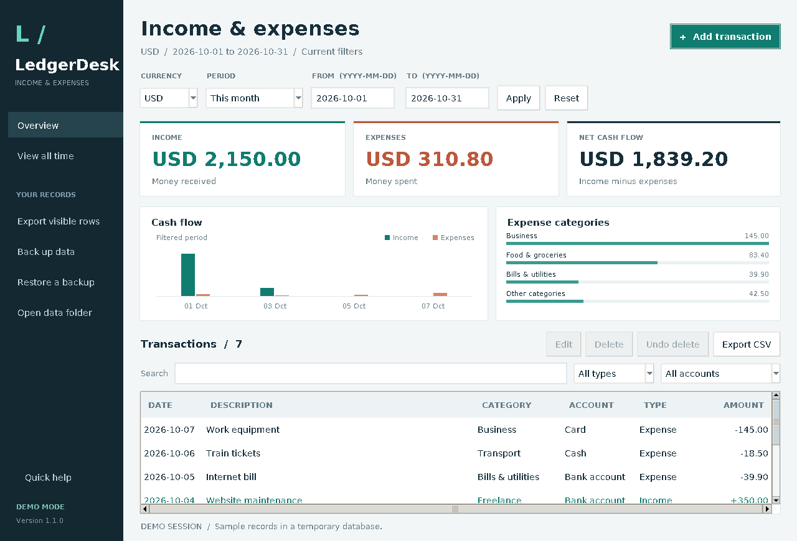

# LedgerDesk

**An offline desktop income and expense tracker by BravenDev.**

Record payments and spending, keep currencies separate, export your records,
and back up your ledger. The Windows download includes its own Python and
Tcl/Tk runtime: extract the ZIP and open **LedgerDesk.exe**.



## Download and run

1. Open this repository's **Releases** page.
2. Download **LedgerDesk-v1.1.0-Windows-x64.zip**.
3. Extract the entire ZIP and double-click **LedgerDesk.exe**.

Designed for Windows 10/11 on x64 PCs. No Python installation, account,
subscription, or API key is required. Keep the `app` and `runtime` folders
beside the EXE when moving or sharing the application folder.

For sample records, launch `LedgerDesk.exe --demo` from a terminal.

## Features

- Add, edit, delete, and undo the most recent deletion.
- Track TRY, USD, EUR, GBP, CAD, and CHF in separate currency views.
- View income, expenses, net cash flow, cash-flow charts, and expense categories.
- Filter by dates, type, account, or text; sort by column.
- Create category and account names, with optional references and notes.
- Export the current view as an Excel-friendly CSV.
- Save a full backup, restore it with a safety copy, and keep daily snapshots.
- Run offline with automatic local saving.

Net cash flow describes selected records, not an opening bank balance. No
currency conversion is applied. The app starts with an empty ledger; the
screenshot and demo use fictional data. See [the user guide](docs/USER_GUIDE.md).

## Your data

On Windows, records are stored at `%LOCALAPPDATA%\LedgerDesk\ledger.sqlite3`,
separately from the app folder. Updating the app preserves that ledger.
Use **Open data folder** to find it and **Back up data** to make a full copy.
Records and exports are ordinary unencrypted files. LedgerDesk makes no
network requests and has no bank connection or cloud sync.

## Run the Python source

Install Python 3.10+ with Tkinter/Tcl/Tk, then run `python income_tracker.py`.
There are no pip dependencies. Linux may need its `python3-tk` system package.
Source launchers are included. Developers can use `python -m pip install .`
to install the `ledgerdesk` GUI command.

## Build the Windows application

Open **Actions → Build Windows app → Run workflow**. The workflow runs data
checks on Linux and Windows, bundles the official runtime, compiles a Windows
launcher, and runs the actual EXE on a Windows runner. Download the ZIP and
checksum from the completed run's **Artifacts**.

On Ubuntu, the equivalent local build is:

```sh
sudo apt-get update
sudo apt-get install -y gcc-mingw-w64-x86-64 msitools
python scripts/build_windows.py
```

The output is `dist/LedgerDesk-v1.1.0-Windows-x64.zip`. Runtime versions, URLs,
and hashes are in [runtime.lock.json](packaging/windows/runtime.lock.json).
Downloads are needed while building; the finished application works offline.

## Publish on GitHub

[GITHUB_SETUP.md](GITHUB_SETUP.md) explains uploading the project and attaching
the Windows ZIP to a release. A matching version tag, such as `v1.1.0`, runs
the workflow and prepares a **draft** release after Windows checks pass.
Open the draft and publish it when ready.

## Verification

```sh
python -m unittest discover -s tests -p "test_*.py" -v
python income_tracker.py --self-test-report self-test-report.json
```

The EXE supports the same `--self-test-report` argument. It opens a temporary
GUI, checks persistence and exports, and writes JSON without touching your real
ledger. Native Windows checks run in GitHub Actions. [VERIFICATION.md](VERIFICATION.md)
records checks actually completed for this delivered package.

## Credits and license

Created by **SamYKar / BravenDev**. Application code uses the [MIT license](LICENSE).
Bundled runtime components retain their own licenses; see [third-party notices](THIRD_PARTY_NOTICES.md).
